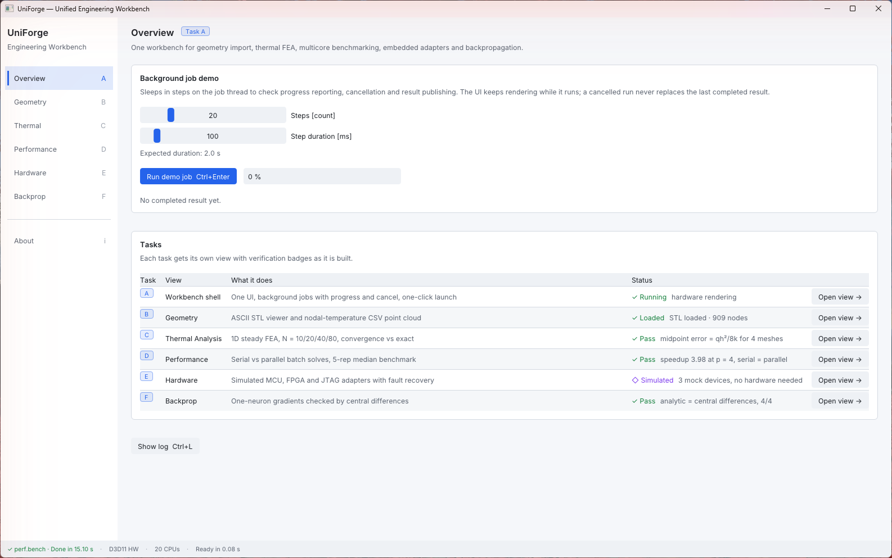

# UniForge: Unified Engineering Workbench

UniForge is a small Windows desktop workbench that imports engineering geometry and
thermal results, solves a 1D thermal finite-element problem, benchmarks serial vs parallel
batch solves, and demonstrates simulated embedded-hardware adapters. All backend logic,
numerics, file processing and concurrency are written in C++17.

> **Status: v1.0.0, submitted.** Candidate ID RA2311042010060 (Aakash G S). Tasks A–F are
> complete. 289 tests pass, and the package was tested from Unicode, read-only and WARP paths.
> Start with the [report](docs/report/report.pdf) (5 pages), then the
> [screenshots](docs/demo/screenshots/), the [ownership statement](docs/ownership.md) and the
> [AI-use log](docs/ai_usage_log.md).



## Features

| Area | Task | What it does | Evidence |
|---|---|---|---|
| Interface & delivery | A | One app with Overview, Geometry, Thermal Analysis, Performance, Hardware, Backprop and About views; one-click `Launch.exe`, ready in ~0.13 s | [edge-case runs](results/edge_cases.md), [screenshots](docs/demo/screenshots/) |
| CAD / ANSYS data | B | ASCII STL viewer and nodal-temperature CSV point cloud with validation, picking and a °C legend | [import limits](results/benchmarks/import_limits.md), [data provenance](data/PROVENANCE.md) |
| Thermal FEA | C | Steady 1D rod solver with two-node linear elements, verified against the analytical solution (midpoint error = qh²/8k, order 2) | [thermal_fea.md](docs/thermal_fea.md), `results/csv/`, `results/plots/` |
| Multicore | D | Serial vs bounded-thread-pool batch solves; speedup 2.00 / 4.00 at p = 2 / 4, results bitwise equal | [performance.md](docs/performance.md), `results/benchmarks/` |
| Embedded design | E | NUCLEO-F446RE / Basys 3 / J-Link EDU Mini integration design with a cited pin/voltage table; simulated C++ adapters with retry and recovery | [embedded_design.md](docs/embedded_design.md) |
| Backpropagation | F | Hand-derived gradients for a one-neuron network, checked by central differences (\|diff\| ≈ 1e-10) | [backprop.md](docs/backprop.md), [handwritten appendix](docs/appendix_handwritten/) |

## Run the packaged app (no build needed)

1. Extract `RA2311042010060_Workbench.zip` anywhere (paths with spaces or non-ASCII characters are fine).
2. Double-click `Launch.exe`.

No installer, administrator rights, internet connection, VC++ redistributable or GPU driver is
needed: the executables link the runtime statically, and rendering falls back to WARP (Windows'
software rasteriser) when no hardware Direct3D 11 device is available. The status bar then shows
"Software rendering".

- **SmartScreen:** the executables are unsigned, so Windows may show "Windows protected your PC"
  on first launch. Choose *More info → Run anyway*.
- **VS Code:** open the extracted folder. *Terminal → Run Build Task* (`Ctrl+Shift+B`) runs
  "Run UniForge (packaged)" with no extension needed; *Run and Debug → Run UniForge (packaged)*
  does the same and needs the C/C++ extension (`ms-vscode.cpptools`).
- **Logs:** `logs/uniforge.log` and `logs/launch.log` next to `Launch.exe`. If that folder is
  read-only, logs and `imgui.ini` go to `%LOCALAPPDATA%\UniForge\` instead.

### Keyboard

| Keys | Action |
|---|---|
| `Ctrl+1` … `Ctrl+7` | Overview, Geometry, Thermal, Performance, Hardware, Backprop, About |
| `Ctrl+L` | Show or hide the log panel |
| `Ctrl+Enter` / `Esc` | Run / cancel the job of the current view |

### Command-line options of `app\UniForge.exe` (diagnostics)

| Option | Effect |
|---|---|
| `--launch-t0=<QPC>` | Passed by `Launch.exe` to measure launch-to-ready |
| `--force-warp` | Skip the hardware device and use WARP (tests the clean-machine path) |
| `--simulate-device-lost` | Treat one Present as `DXGI_ERROR_DEVICE_REMOVED` (tests recovery) |
| `--simulate-crash` | Raise an unhandled exception after start-up (tests the crash handler: `logs/crash_<pid>.txt` + message box) |
| `--theme=light` / `--theme=dark` | Override the Windows app-mode theme |

## Regenerate the evidence (`app\uniforge_cli.exe`)

Double-click `regenerate_evidence.cmd` in the package folder. It only runs
`app\uniforge_cli.exe all --out results` from the package root, so the package folder must be
writable. The command-line tool uses the same C++ core as the GUI:

| Command | Writes |
|---|---|
| `uniforge_cli fea [--out DIR]` | Thermal FEA (Task C), N = 10, 20, 40, 80: `DIR/csv/fea_N*_nodes.csv`, `fea_N*_midpoints.csv`, `convergence.csv` (each with a `.meta.json` sidecar: version, git commit, parameters, units, UTC time) and `DIR/plots/T_vs_x.svg`, `error_vs_h_loglog.svg` |
| `uniforge_cli gen-samples [--data DATA]` | Task B samples: `DATA/geometry/rod_10x10mm_1m.stl`, `heatsink_fins.stl`, `DATA/thermal/rod_nodal_temperature_SYNTHETIC.csv`; reads each back and prints PASS/FAIL checks ([data/PROVENANCE.md](data/PROVENANCE.md)) |
| `uniforge_cli inspect FILE...` | Nothing: imports `.stl` / `.csv` files with the GUI's parsers and prints the summary and warnings, or the error with its code, line and hint (exit code 1 if a file is rejected) |
| `uniforge_cli import-bench [--sizes N,...] [--out DIR]` | `DIR/benchmarks/import_limits.md`, `.csv` (+ `.meta.json`): parse time and peak memory for generated STL/CSV files of 10 k, 100 k, 1 M elements and at the import limits. Writes up to ~0.5 GB of temporary files (one at a time, in the system temp folder) and deletes them. Machine-specific, so not part of `all` |
| `uniforge_cli bench [--quick \| --report] [--seed S] [--cases C] [--elements N] [--workers 1,2,4] [--status TEXT] [--out DIR]` | Task D benchmark: `DIR/benchmarks/bench_<UTC date>.{md,csv,json}` + `.meta.json` + `_timing/_speedup/_efficiency.svg`. Serial vs parallel batch of rod solves, 1 warm-up + 5 timed reps per p (capped at the logical CPU count), median/min/max, speedup, efficiency, max \|ΔT\| serial vs parallel. `--report` (default): 10 000 cases × 8 000 elements, seed 20261101, T1 ≈ 1 s on an i5-14600K, needs ~1.3 GB RAM; `--quick`: 500 × 1 000. Exit code 3 if agreement fails. Machine-specific; the committed report is regenerated with `tools/bench_report.ps1` |
| `uniforge_cli backprop [--out DIR]` | Backprop (Task F), brief values: `DIR/csv/backprop_gradients.csv` (analytic vs central FD, ε = 1e-6, pass at ≤ 1e-5), `backprop_update.csv` (one simultaneous step), `loss_curve.csv` (steps 0–100), each with a `.meta.json` sidecar, and `DIR/plots/loss_curve.svg`, `loss_curve_logy.svg` ([docs/backprop.md](docs/backprop.md)) |
| `uniforge_cli all [--out DIR] [--data DATA]` | `fea` + `backprop` + `gen-samples` + a quick bench into `DIR/benchmarks/quick/` |

`DIR` defaults to `results`, `DATA` to `data`. CSVs, SVGs and sample files are byte-identical on
every run (only the sidecars carry a timestamp). The tool prints PASS/FAIL verification checks;
exit codes: 0 ok, 1 error, 2 bad command line, 3 a check failed. Formulation and verification:
[docs/thermal_fea.md](docs/thermal_fea.md).

## Supported file formats (Task B)

| Format | Accepted | Rejected with a line-numbered message |
|---|---|---|
| **ASCII STL** (`.stl`) | `solid` / `facet normal` / `outer loop` / 3 × `vertex` / `endloop` / `endfacet` / `endsolid`; any letter case; blank lines; several solids (merged); UTF-8 BOM; LF or CRLF. Coordinates are taken as metres. | empty file (0 bytes) and solid without facets (different messages), binary STL ("Export as ASCII STL"), unknown or misplaced keywords, wrong vertex or coordinate count, text, NaN/Inf or out-of-range numbers, a file that ends inside a facet (truncated) |
| **Nodal temperature CSV** (`.csv`) | header exactly `node_id,x_m,y_m,z_m,temperature_C` (spaces around names allowed), integer `node_id`, decimal numbers with `.`; UTF-8 BOM; LF or CRLF; blank lines | header-only file ("No data rows"), wrong header (with a hint for `;` separators), missing or extra columns, quoted fields, empty or non-numeric values, NaN/Inf, duplicate `node_id`, temperatures below −273.15 °C |

Zero facet normals are recomputed from the vertex order; degenerate (zero-area) triangles are
kept and reported as a warning. A CSV whose file name contains `SYNTHETIC` is flagged as
synthetic data. Numbers are parsed with `std::from_chars`, so the Windows region setting (decimal
comma) does not matter.

**Tested size limits** (measured by `uniforge_cli import-bench` on an i5-14600K / 32 GB, full
table in [results/benchmarks/import_limits.md](results/benchmarks/import_limits.md)):

| Limit | Value | Measured at the limit |
|---|---:|---|
| STL facets | 2,000,000 | 496 MB file, 2.0 s, 270 MB peak memory |
| CSV nodes | 5,000,000 | 275 MB file, 1.3 s, 318 MB peak memory |
| File size | 512 MiB | — (largest file measured: 496 MB) |
| Line length | 4,096 characters | — |

Larger files are refused with `LimitExceeded` and the limit in the message, never half-loaded.
The sample files and their provenance (the CSV is **SYNTHETIC, not an ANSYS export**) are
described in [data/PROVENANCE.md](data/PROVENANCE.md).

## Prerequisites (source build)

- Windows 11 x64
- Visual Studio 2022 Build Tools (workload: *Desktop development with C++*, MSVC v143, Windows 11 SDK)
- CMake ≥ 3.25. The copy bundled with the Build Tools works; it is on `PATH` inside
  *Developer PowerShell for VS 2022*, or add
  `<BuildTools>\Common7\IDE\CommonExtensions\Microsoft\CMake\CMake\bin` to `PATH`.

All libraries and fonts are vendored in `third_party/`; the build needs no internet access.

## Build from source

```bash
cmake --preset windows-msvc
cmake --build --preset windows-release
ctest --preset windows-release
```

The executables land in `build/windows-msvc/bin/Release/`. Run one test label with
`ctest --preset windows-release -L unit`.

## Package

```bash
powershell -ExecutionPolicy Bypass -File tools/package.ps1
```

This configures, builds Release, runs the tests, stages `dist/RA2311042010060_Workbench/`, checks with
`dumpbin /dependents` that the executables import only Windows DLLs, runs the hygiene scan
(`tools/hygiene_scan.ps1`: absolute paths, e-mail addresses, secrets) and writes
`dist/RA2311042010060_Workbench.zip`. The repository's VS Code configuration has "Run packaged (dist)"
to start that staged copy.

The package also contains `git/UniForge.bundle` (full history of `main` and the phase tags;
`git clone git/UniForge.bundle UniForge` restores the repository offline) and `git/git_log.txt`.
`tools/edge_case_runs.ps1` then exercises the staged package from a Unicode path, a read-only
folder, WARP and a simulated crash ([results/edge_cases.md](results/edge_cases.md)), and
`tools/build_report.ps1` rebuilds `docs/report/report.pdf` from its HTML source with headless Edge.

Linux (core library and tests only, used by CI from Phase 5):

```bash
cmake --preset linux-release
cmake --build --preset linux-release
ctest --preset linux-release
```

## Repository layout

```text
cmake/          compiler options, warnings, HLSL shader compilation
third_party/    Dear ImGui, ImPlot, GoogleTest, fonts (pinned; see DEPENDENCIES.md), patches/
LICENSES/       third-party licence texts
src/core/       portable C++17 engineering core (standard library only): common/ (Result, Error,
                CSV/SVG/JSON writers, Rng), thermal/ (1D FEA), io/ (line reader, STL and CSV
                importers), perf/ (batch generator, worker pool, runners, benchmark, SystemInfo),
                hw/ (simulated device adapters, retry policy), ml/ (one-neuron backprop)
src/app/        UniForge.exe: platform/ (Win32, D3D11, crash handler), services/ (JobRunner,
                LogSink, ResultStore, DeviceManager), render/ (3D viewport), ui/ (theme, fonts,
                shell, widgets), views/, shaders/
src/launcher/   Launch.exe (starts app\UniForge.exe; no application logic)
src/cli/        uniforge_cli.exe (headless evidence generator on the same core; platform/ holds
                the process-memory and child-process calls of import-bench)
tests/          unit, numerical, negative and integration tests (GoogleTest + CTest labels),
                fixtures/ (one malformed STL/CSV file per failure mode), golden/ (expected CLI
                output)
data/           sample STL and SYNTHETIC CSV files, PROVENANCE.md
results/        committed evidence: csv/ (with .meta.json sidecars), plots/, benchmarks/,
                edge_cases.md
tools/          package.ps1, hygiene_scan.ps1, bench_report.ps1, edge_case_runs.ps1,
                build_report.ps1, ZIP-specific VS Code config and regenerate_evidence.cmd
                wrapper (no backend logic)
docs/           report/, design/, task notes (thermal_fea, performance, embedded_design,
                backprop), ownership, walkthrough, demo script, AI-use and effort logs,
                demo/screenshots/, appendix_handwritten/
```

## Known limitations

- Unsigned executables trigger SmartScreen on first launch (see above).
- No screen-reader support: Dear ImGui exposes no UI Automation tree.
- Not checked: 200 % display scaling, full keyboard-only use, high-contrast mode.
- Hardware is simulated (Task E): the design is cited from datasheets but not tested on boards.
- The nodal-temperature sample CSV is synthetic (labelled as such); no real ANSYS export ships.
- The embedded fonts cover Latin, Greek and the symbols the UI uses; other scripts (e.g. CJK
  characters in a folder name shown on the About page) display as `?`. File access itself works
  with any Unicode path.

## Documentation

- **[Report (PDF, 5 pages)](docs/report/report.pdf)**, [ownership statement](docs/ownership.md),
  [walkthrough for the verification discussion](docs/walkthrough.md), [demo script](docs/demo_script.md)
- [Screenshots of every view](docs/demo/screenshots/) and [edge-case runs](results/edge_cases.md)
- Demo video: `RA2311042010060_Demo.mp4` (submitted alongside the ZIP; 57 MB, too large for the repository), recorded from the packaged app following the demo script
- [Final build specification](docs/design/UniForge_Final_Build_Spec.md)
- [Thermal FEA: formulation, verification, debugging log](docs/thermal_fea.md)
- [Multicore performance analysis](docs/performance.md) and [embedded integration design](docs/embedded_design.md)
- [Backpropagation: derivation and measured loss curve](docs/backprop.md) and the [handwritten-appendix checklist](docs/appendix_handwritten/CHECKLIST.md)
- [Sample data provenance](data/PROVENANCE.md) and [measured import limits](results/benchmarks/import_limits.md)
- [Dependencies and licences](DEPENDENCIES.md)
- [AI-use log](docs/ai_usage_log.md)
- [Effort log](docs/effort_log.md)

## Licence

MIT, see [LICENSE](LICENSE). Third-party components are listed in [DEPENDENCIES.md](DEPENDENCIES.md).
