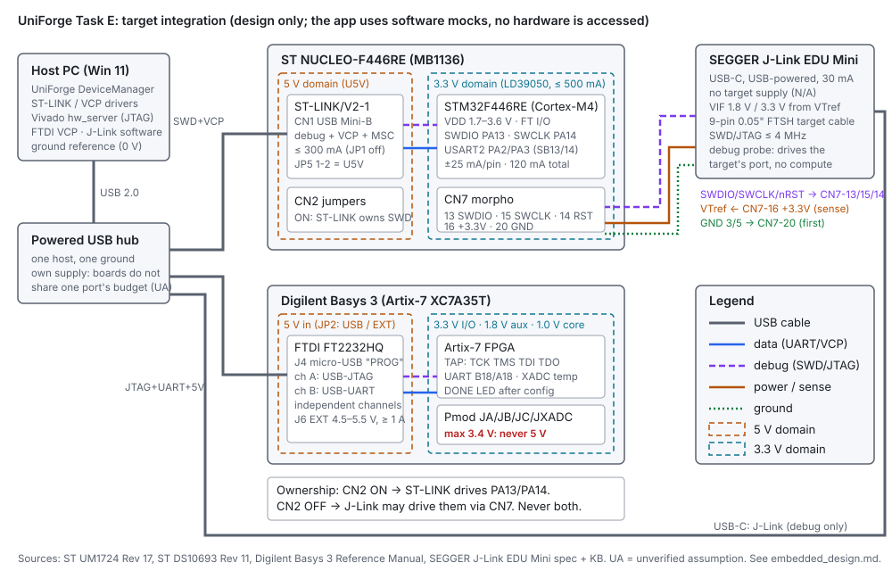

# Embedded integration design (Task E)

**Scope.** How a workbench host PC would talk to three development tools, and the safety rules
for connecting them. Physical wiring, PCB work and FPGA programming are out of scope. **The
UniForge Hardware view does not access hardware.** Its three adapters are software simulations
(`src/core/hw`), and every card in the view is labelled SIMULATED.

**Boards** (spec D10, kept after the datasheet check):

| Role | Board | Why |
|---|---|---|
| Microcontroller | ST **NUCLEO-F446RE** (MB1136, STM32F446RET6) | On-board ST-LINK/V2-1 gives SWD debug and a virtual COM port over one USB cable [S1 §7.4] |
| FPGA | Digilent **Basys 3** (Artix-7 XC7A35T-1CPG236C) | One micro-USB cable carries power, USB-JTAG configuration and USB-UART [S3 "USB-UART Bridge"] |
| Debug probe | SEGGER **J-Link EDU Mini** | Separate JTAG/SWD probe for an Arm Cortex-M target. Licensed for non-profit educational use only [S4] |

All three were kept. The check did change one assumption in the spec: the EDU Mini has a
**9-pin 0.05" Samtec FTSH** connector, not a 10/20-pin header [S4], and SEGGER describes its
functionality as being "for Cortex-M based targets" [S6]. Its target in this design is therefore
the Nucleo's STM32F446 (Cortex-M4). The Basys 3 FPGA stays on its own on-board USB-JTAG.

## 1. Interface and pin-voltage table

Every value has a citation. Rows marked **UA** are unverified assumptions.

| | NUCLEO-F446RE | Basys 3 | J-Link EDU Mini |
|---|---|---|---|
| **Power source** | ST-LINK USB CN1 (U5V, JP5 1-2, default). Or E5V 4.75–5.25 V / 500 mA (CN7 pin 6). Or VIN 7–12 V (CN6 pin 8, CN7 pin 24, 800 mA at 7 V falling to 250 mA at 9–12 V). Or +3.3V 3–3.6 V in, which leaves the ST-LINK unpowered [S1 §7.5.1–7.5.3, Tables 7, 9] | USB-JTAG port J4, or 5 V external on J6 at 4.5–5.5 V and ≥ 1 A. Jumper JP2 selects the source; SW16 switches power [S3 "Power"] | USB-powered, max. 30 mA. Supplies **no** target power ("Target supply voltage: N/A") [S4] |
| **USB current** | 100 mA before enumeration, 300 mA requested at enumeration. JP1 ON caps it at 100 mA. Above 300 mA, E5V or VIN is mandatory [S1 §7.5.1, Table 6] | Rail budget: 3.3 V up to 2 A (0.1–1.5 A typical), 1.0 V up to 2 A, 1.8 V up to 300 mA [S3 "Power" table]. USB draw is not specified (**UA**) | 30 mA [S4] |
| **Voltage domains** | 5 V (U5V/E5V), 3.3 V from regulator LD39050PU33R (SB2), 500 mA max out [S1 §7.5.4, Table 10]. MCU VDD 1.7–3.6 V [S2 Features] | 5 V in, then 3.3 V (FPGA I/O, Pmods), 1.8 V (aux/RAM), 1.0 V (core) [S3 "Power"] | VIF 1.8 V or 3.3 V, taken from VTref [S4] |
| **Ground** | GND on CN7 pins 8, 19, 20, 22 [S1 Table 29]. USB shield/ground goes to the host (**UA**: through the USB cable, as for any bus-powered device) | Pmod pins 5 and 11 = GND [S3 "Pmod Ports"]. J6 has a GND pin [S3 "Power"] | Connector pins 3 and 5 = GND, "should also be connected to GND in the target system" [S5] |
| **I/O level** | 3.3 V (VDD from the on-board 3.3 V rail, **UA**: rail = VDD with JP6 ON [S1 §7.8]). Most pins are FT (5 V tolerant). Abs. max V_IN on FT pins = VDD + 4.0 V. ±25 mA per pin, ±120 mA in total [S2 §6.2 Tables 13–14]. V_IH min 0.7·VDD (tested), V_IL max 0.3·VDD [S2 §6.3.17 Table 56] | LVCMOS 3.3 V on Pmods. "Care should be taken not to drive these pins over 3.4 V". Pmod VCC/GND deliver up to 1 A [S3 "Pmod Ports"]. Buttons and switches have series resistors; LEDs have 330 Ω [S3 "Basic I/O"] | Signal levels follow VTref. VTref draws < 170 µA. nRESET is open drain with 150 Ω series resistance [S4] |
| **Connectors** | CN1 USB Mini-B (ST-LINK). CN2 = ST-LINK/Nucleo selector. CN4 = 6-pin SWD *output* to an external target. CN7/CN10 ST morpho. CN5/6/8/9 Arduino [S1 §6.1, §7.1, §7.12–7.14] | J4 micro-USB "PROG" (JTAG + UART). J5 = external JTAG header, underside, unlabelled. J2 USB-A HID host. Pmods JA/JB/JC/JXADC are 2×6 at 100 mil [S3] | USB-C to host. 9-pin 0.05" Samtec FTSH to the target [S4] |
| **Host communication** | ST-LINK/V2-1 on USB: debug port, virtual COM port and mass storage [S1 §7.4]. The VCP is USART2 on PA2/PA3 with SB13 and SB14 ON (default) [S1 §7.10] | FTDI FT2232HQ. One channel is the USB-UART on FPGA pins B18/A18, the other is Digilent USB-JTAG. The two are "entirely independent" [S3 "USB-UART Bridge"] | USB 2.0 Full-Speed. SWD/JTAG up to 4 MHz; SWO sampling up to 4 MHz [S4] |
| **Debug signals** | SWDIO = PA13 (JTMS), SWCLK = PA14 (JTCK), JTDI = PA15, JTDO/SWO = PB3, NJTRST = PB4, all FT [S2 §4 Table 10 p. 45]. On morpho: SWDIO CN7-13, SWCLK CN7-15, RESET CN7-14, +3.3V CN7-16 [S1 Table 29] | Artix-7 TAP (TCK/TMS/TDI/TDO), owned by the on-board USB-JTAG. An external programmer can use J5 [S3 "JTAG Programming"]. J5 pinout is not in the manual (**UA**) | Pin 1 VTref, 2 SWDIO/TMS, 4 SWCLK/TCK, 6 SWO/TDO, 8 TDI, 9 nTRST on the EDU Mini, 10 nRESET, 3/5 GND [S5, S6] |
| **Level shifting** | Not needed toward the J-Link: both sides are 3.3 V and the probe follows VTref | **Needed for any 5 V source**: the Pmods must stay ≤ 3.4 V [S3]. A Nucleo 5 V pin (U5V, E5V, +5V) or a 5 V Arduino shield signal must never reach a Pmod pin | Not needed: VIF tracks VTref (1.8 or 3.3 V) [S4]. A 5 V target would be outside the stated VIF (**UA**: treat as unsupported) |

**Pinout assumptions (UA).** (1) J-Link → Nucleo goes over five flying leads from the 9-pin
FTSH to CN7 (VTref→16, SWDIO→13, SWCLK→15, nRESET→14, GND→20). No SEGGER adapter for that
pairing is cited here. (2) An optional MCU↔FPGA link would use USART1 (PA9 CN10-21, PA10
CN10-33 [S1 Table 29]) to Pmod JA, both at 3.3 V, so no shifter is needed. USART2 is avoided
because SB13/SB14 tie it to the VCP [S1 §7.10]. The baseline design does not include this
link. (3) The FTDI UART direction on B18/A18 is taken from Digilent's master XDC, not from the
reference manual.

## 2. Why the JTAG adapter is not a compute board

A JTAG/SWD probe drives **another device's** Test Access Port (TCK/TMS/TDI/TDO) or SW-DP
(SWDIO/SWCLK). It halts and steps a CPU, reads and writes its memory and flash, and does
boundary scan. It runs no application code and produces no telemetry of its own. The pins it
uses **belong to the target's debug port**. Its pin 1, **VTref**, is an *input* that senses the
target's I/O voltage. The probe uses VTref "to check if the target has power" and to set its own
output levels [S5]. The EDU Mini supplies no target power [S4]. In the mock, therefore, the
probe's telemetry is limited to what it measures *about its target* (`vtref_V`, `idcode`). The
MCU and FPGA adapters report their own on-chip sensors.

**No shared connector, voltage or protocol may be assumed.** The three tools use different
connectors: USB Mini-B + morpho, micro-USB + Pmod, and USB-C + 9-pin FTSH. They have different
supplies: 5 V USB with jumper-selected inputs, 5 V with JP2, and USB-only with no target supply.
They allow different I/O levels: FT 5 V-tolerant pins against a 3.4 V maximum against a 1.8 or
3.3 V VIF. They also speak different protocols: SWD + UART, Xilinx JTAG + UART, and SWD/JTAG
only. Each link is defined explicitly in §1, and the adapters in software share only an
interface (`IDeviceAdapter`), not a transport.

**Ownership conflict on the Nucleo.** The on-board ST-LINK and an external J-Link cannot both
drive PA13/PA14:

| CN2 jumpers | Who owns the F446 SWD pins | Source |
|---|---|---|
| Both ON (default) | On-board ST-LINK. "Do not use the CN4 connector as this could disturb communication" | [S1 §7.4.4, Table 4] |
| Both OFF | ST-LINK is disconnected from the on-board MCU. Its SWD goes to CN4 for an *external* target, which leaves PA13/PA14 free for the J-Link on CN7-13/15 | [S1 §7.4.5, Table 4, §7.3] |

The ST-LINK NRST also reaches the target through SB12 [S1 Table 10]. With the J-Link driving
nRESET, leave SB12 as is but do not let both tools reset at once. (**UA**: the manual only asks
for SB12 OFF when CN4 pin 5 drives an external board. Alternatively, leave J-Link nRESET
unconnected and use a software reset over SWD.) PA13/PA14 must not be used as GPIO while the
ST-LINK part is attached [S1 Table 29 note 3].

## 3. Safe integration plan

1. **One device at a time.** Bring up and verify each board alone on the host before connecting
   any two of them: Nucleo, then Basys 3, then the J-Link.
2. **Common ground first, signals last.** Connect GND (J-Link pins 3/5 to CN7-20) before any
   signal lead [S5], and disconnect it last. All three share the host ground over USB (**UA**:
   use one hub and one host, never two PCs).
3. **Check VTref before driving.** Power the target, measure CN7-16 (+3.3 V), confirm that the
   J-Link reports VTref ≈ 3.3 V, and only then start a debug session. If VTref is missing, do not
   connect. The probe would be driving an unpowered target.
4. **Power sequencing on the Nucleo.** If VIN/E5V is used, set JP5 2-3 and remove JP1. Switch
   the external supply on and check LD3 before plugging USB into CN1. The wrong order risks
   damage to the host or a failed enumeration [S1 §7.5.2].
5. **No back-powering.** Never feed +3.3V while the ST-LINK is fitted unless SB2 and SB12 are
   OFF [S1 §7.5.3]. Never connect a Nucleo 5 V pin to a Basys Pmod [S3]. Basys 3: one source
   only, set by JP2 [S3].
6. **Current limits.** Nucleo ≤ 300 mA on USB, or else E5V/VIN [S1 Table 6 warning]. 3.3 V
   regulator ≤ 500 mA [S1 §7.5.4]. MCU pins ±25 mA each, 120 mA total [S2 Table 14]. Basys
   Pmod VCC ≤ 1 A, external supply ≥ 1 A capable [S3]. Use a powered hub so the three boards do
   not share one port's budget (**UA**: the hub's rating is not specified here).
7. **ESD.** Handle the boards in an ESD-safe environment and do not touch the connectors while
   powered [S1 §5.2]. The F446 ESD ratings are in [S2 §6.3.15, Table 53].
8. **Configuration check.** Before power-up confirm JP5, JP1, JP6 ON and CN2 on the Nucleo, and
   JP1 (mode) and JP2 (power) on the Basys 3.

## 4. Limitations

- Nothing here was measured. The values come from the vendor documents listed below, and no
  bench verification was done.
- The Hardware view's adapters are mocks with seeded, made-up telemetry: `vdd_V` ≈ 3.3,
  `die_temp_C`, `xadc_temp_C`, `done`, `vtref_V`, and a fixed **simulated** `idcode`. None of
  these numbers is a reading from a device. The IDCODE value was not checked against the Arm or
  ST reference manuals (**UA**).
- The F446 temperature sensor "is mainly suitable for applications that detect temperature
  changes instead of absolute temperatures" [S2 §3.38]. A real `die_temp_C` would be relative.
- Not cited from a primary document (**UA**): the J5 pinout, the Basys 3 USB current draw, the
  UART pin direction, the USB 2.0 port budget, and whether the EDU Mini can scan a Xilinx TAP.
  The design does not depend on the last one.
- The J-Link EDU Mini licence prohibits commercial use [S4]. A paid J-Link (or the ST-LINK
  alone) would replace it outside education.

## Sources (accessed 2026-11-01)

- **[S1]** STMicroelectronics, *UM1724 User manual: STM32 Nucleo-64 boards (MB1136)*, Rev 17,
  September 2025. Sections and tables as cited (§7.4 p. 17–20, §7.5 p. 21–23, Table 10 p. 27,
  Table 29 p. 59).
  <https://www.st.com/resource/en/user_manual/um1724-stm32-nucleo64-boards-mb1136-stmicroelectronics.pdf>
- **[S2]** STMicroelectronics, *DS10693 STM32F446xC/E datasheet*, Rev 11, May 2026 (Features
  p. 1, Table 10 p. 45, §3.38 p. 38, §6.2 p. 73, §6.3.15 p. 115, §6.3.17 p. 117).
  <https://www.st.com/resource/en/datasheet/stm32f446re.pdf>
- **[S3]** Digilent, *Basys 3 Reference Manual* (web edition; no revision number shown).
  Sections "Power", "FPGA Configurations", "USB-UART Bridge", "Basic I/O", "Pmod Ports", FAQ
  "Where is J5".
  <https://digilent.com/reference/programmable-logic/basys-3/reference-manual>
- **[S4]** SEGGER, *J-Link EDU Mini* product page, "Technical specifications" table.
  <https://www.segger.com/products/debug-probes/j-link/models/j-link-edu-mini/>
- **[S5]** SEGGER Knowledge Base, *9-pin JTAG/SWD connector* (pinout table).
  <https://kb.segger.com/9-pin_JTAG/SWD_connector>
- **[S6]** SEGGER Knowledge Base, *J-Link EDU Mini* ("JTAG nTRST signal").
  <https://kb.segger.com/J-Link_EDU_Mini>
