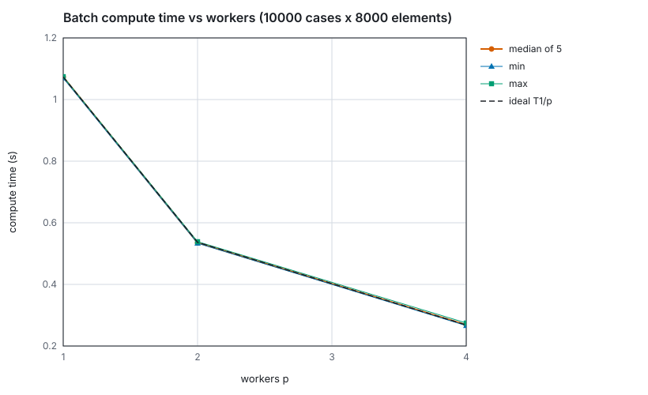
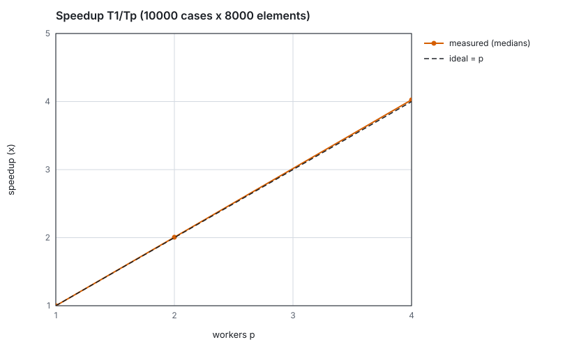
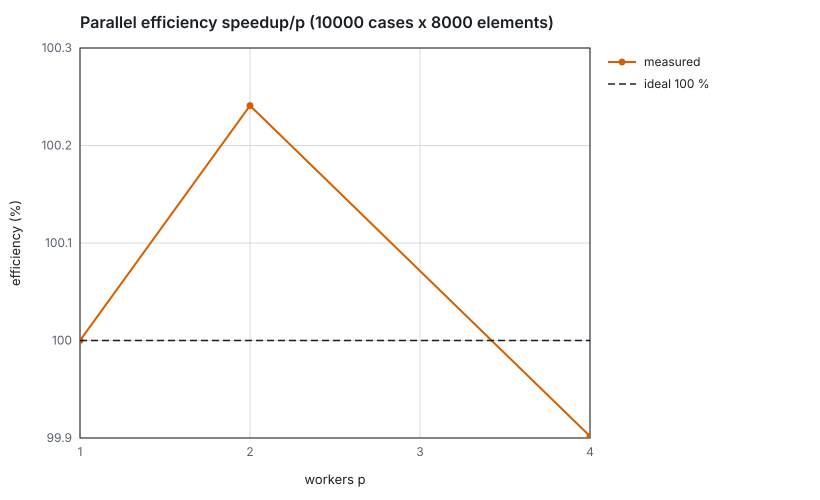

# Task D: multicore batch benchmark

UniForge solves a batch of independent 1D rod problems (the Task C solver, unchanged) once
serially and once on a CPU worker pool, checks that both give the same temperatures, and
times them with a fixed protocol. This page explains the method, shows the measured results
and discusses what limits the speedup.

> **Status of the numbers below.** The committed results section is **provisional**: it was
> generated on the development machine during a night when other build sessions shared it, and
> the machine was not checked to be idle. The final report is regenerated on a quiet machine with
> one command (see [Regenerating](#regenerating-the-report)), which replaces the files and the
> results section.

## Method

### Workload (D2)

- `generateBatch(seed, cases, N)` (`src/core/perf/BatchGenerator.cpp`) draws, for each case
  in order, k ~ U[5, 50) W/(m·K) and q ~ U[1e3, 5e4) W/m³. L = 1 m, A = 1e-4 m², T0 = 100 °C
  and TL = 20 °C keep the brief's values; every case has the same N.
- Random numbers come from `std::mt19937_64` (its output is fixed by the C++ standard) with
  UniForge's own mapping to [a, b): top 53 bits × 2⁻⁵³, then a + (b − a)·u. The standard
  `std::uniform_real_distribution` is implementation-defined, so it would give different
  batches on MSVC and GCC. Test vectors in `tests/unit/common/RngTest.cpp` and
  `tests/unit/perf/BatchGeneratorTest.cpp` pin the values; the Linux CI jobs check them with
  GCC.
- Report preset: seed 20261101, **10 000 cases × 8 000 elements** (80 M unknowns per batch).
  The spec's first guess, 4 000 × 4 000, measured T1 = 0.21 s on the i5-14600K; the preset was
  enlarged so the serial time is above 1 s and timer and thread start-up effects stay small.
  Quick preset (UI and `uniforge_cli all`): 500 × 1 000.

### Serial and parallel runners (D1)

- Both runners call the same `solveCase()` (`src/core/perf/SerialRunner.cpp`): it lends the
  preallocated `out[i].T` to `solveRod` and records the peak temperature. Same code and same
  inputs means the parallel result is **bitwise** equal to the serial one, not just close.
- `WorkerPool` (`src/core/perf/WorkerPool.cpp`) starts p `std::thread`s per run. Workers take
  chunks of `max(1, cases / (8p))` consecutive case indices from one `std::atomic<size_t>`
  and write only `out[i]` for their own indices, so there are no locks or shared writes on the
  hot path and index order is preserved. Each worker owns its solver scratch (stiffness
  diagonals, Thomas buffer, node coordinates). All threads are joined before `run()` returns;
  an exception in a worker becomes `Error{Internal}` after the join, and the cancel flag is
  checked before every case.
- p = 1 is the serial runner on the calling thread (no pool), which makes T1 the honest serial
  baseline.

### Timing protocol (D3, D4)

| Step | Inside the timed region? |
|---|---|
| Generate the batch | no |
| Allocate both result sets (2 × 640 MB) and fill them with NaN | no (this also takes the page faults) |
| Start p threads, solve all cases, join | **yes** (`std::chrono::steady_clock`) |
| Compare every node of every case with the serial reference | no |

- Worker counts p ∈ {1, 2, 4} ∩ [1, logical CPUs]; requests above the logical count are capped
  and the cap is written into the report. With one logical CPU, p = 2 still runs as a
  correctness demonstration and the report says "speedup not assessable".
- Per p: **1 warm-up + 5 timed repetitions**; the report gives median, min and max, speedup
  T1/Tp (medians) and efficiency speedup/p.
- Agreement: the serial warm-up output is the reference. Every timed repetition, serial and
  parallel, is compared node by node: max |T_serial − T_run| over all 80 M nodes of all
  repetitions must be ≤ 1e-8 °C. The NaN pre-fill means a case that was skipped can never pass
  with old numbers. Order: each case's peak temperature must match the serial one at the same
  index (cases differ in k and q, so a misplaced result would show).
- Launch-to-ready (D4) is measured separately from this benchmark: Launch.exe start to first
  presented frame, shown in the About view and appended to `logs/launch.log` (Phase 1).

### Machine and build

Recorded automatically in every report by `querySystemInfo()` (`src/core/perf/SystemInfo_win.cpp`
via `GetLogicalProcessorInformationEx`, `GlobalMemoryStatusEx`, `RtlGetVersion`, CPUID;
`SystemInfo_linux.cpp` via `/proc` and `/etc/os-release`): CPU, physical and logical cores,
P/E split, RAM, OS build, compiler version and the compile flags of the build.

## Results

<!-- BENCH:BEGIN (generated by tools/bench_report.ps1, do not edit by hand) -->
> **PROVISIONAL: development machine during a night of parallel build sessions, not checked to be idle; replaced by a quiet-machine run at integration**

Generated 2026-11-01T22:41:19Z by `uniforge_cli bench` 0.1.0 (commit b1cdb54d79b0).  
Regenerate: `uniforge_cli bench --report`

### Machine and build

| Item | Value |
|---|---|
| CPU | Intel(R) Core(TM) i5-14600K |
| Cores | 14 physical, 20 logical; 6 performance + 8 efficiency cores (hybrid) |
| RAM | 31.8 GB |
| OS | Windows 11 (10.0.26200), x64 |
| Compiler | MSVC 19.44.35229 |
| Flags | `/DWIN32 /D_WINDOWS /EHsc /O2 /Ob2 /DNDEBUG /MT /W4 /utf-8 /permissive-` |
| Build | Release |

### Workload

| Item | Value |
|---|---|
| Cases | 10000 independent rods (k ~ U[5, 50] W/(m·K), q ~ U[1e3, 5e4] W/m³; L = 1 m, A = 1e-4 m², T0 = 100 °C, TL = 20 °C) |
| Elements per case | 8000 |
| Seed | 20261101 |
| Workers | requested 1, 2, 4; run 1, 2, 4 |
| Protocol | 1 warm-up + 5 timed repetitions per p; median, min, max |
| Result set | 640.1 MB (preallocated) |

### Results

| p | threads | median (s) | min (s) | max (s) | speedup T1/Tp | efficiency |
|---:|---:|---:|---:|---:|---:|---:|
| 1 | 1 | 1.0671 | 1.0625 | 1.0746 | 1.00 | 100 % |
| 2 | 2 | 0.5318 | 0.5312 | 0.5378 | 2.01 | 100 % |
| 4 | 4 | 0.2651 | 0.2646 | 0.2654 | 4.03 | 101 % |

All repetitions (s):

| p | warm-up | rep 1 | rep 2 | rep 3 | rep 4 | rep 5 |
|---:|---:|---:|---:|---:|---:|---:|
| 1 | 1.0732 | 1.0671 | 1.0625 | 1.0746 | 1.0645 | 1.0689 |
| 2 | 0.5335 | 0.5318 | 0.5312 | 0.5314 | 0.5378 | 0.5321 |
| 4 | 0.2653 | 0.2651 | 0.2652 | 0.2654 | 0.2649 | 0.2646 |

### Agreement

- max |T_serial − T_parallel| over all nodes of all cases: **0 °C** (required ≤ 1e-8 °C): PASS
- Index order preserved (out[i] ↔ case i): yes

### Notes

- Timed region: the batch solve only (steady_clock). Batch generation, the two preallocated result sets (640.1 MB each), the NaN pre-fill and the agreement check run outside it.
- p = 1 is the serial runner on the calling thread. p >= 2 start p std::threads per repetition (thread start-up and join are inside the timed region) that take chunks of max(1, cases / (8p)) cases from an atomic index.
- Agreement: every timed repetition (serial and parallel) is compared node by node with the serial warm-up result.







Source files: [`bench_2026-11-01.md`](../results/benchmarks/bench_2026-11-01.md),
[`bench_2026-11-01.csv`](../results/benchmarks/bench_2026-11-01.csv), [`bench_2026-11-01.json`](../results/benchmarks/bench_2026-11-01.json).
<!-- BENCH:END -->

## Analysis

The paragraphs below were written against the provisional run. They use the measured shape
(near-linear up to p = 4) rather than exact digits; recheck the digits after the quiet-machine
run replaces the results section.

### Why the speedup is close to ideal

Each case is an independent solve: assembly and a Thomas sweep over N + 1 = 8 001 unknowns,
O(N) work with no communication between cases. The only shared state is the atomic chunk
counter, touched once per chunk, and each worker writes its own 64 KB slice of the result
buffer. That is close to the best case for threads, and the measured efficiency at p = 4 is
97-101 % (101 % in the committed run, 97 % in an earlier run under load). Slightly above
100 % is not a real superlinear effect: it is within the run-to-run variation of T1 (1.058 s and
1.067 s in two quiet runs a few minutes apart).

### Where the remaining time goes (overhead)

- **Thread start and join.** p threads are created and joined inside every timed
  repetition. On Windows that costs tens of microseconds per thread, which is under 0.1 % of a
  ~0.3 s parallel run. It would matter for the quick preset (a few milliseconds per run), which
  is why the report uses the large preset.
- **Chunk scheduling.** With 10 000 cases and p = 4 the chunk is 312 cases (≈ 39 ms of work),
  32 chunks in total, so the atomic counter costs nothing measurable. The price of chunking is
  the tail: when the last chunk starts, the other workers may idle for up to one chunk. All
  cases have the same N, so they cost the same and the workers finish within a fraction of a
  chunk of each other; a smaller chunk would cut the tail further at the cost of more counter
  traffic.
- **Allocation.** Result buffers are allocated and touched before timing. Each worker's
  solver scratch (~0.4 MB) is allocated inside the timed region on its first case; the serial
  runner pays the same once, so the comparison stays fair.

### Memory behaviour

Per solve, the working set at N = 8 000 is the tridiagonal system (four arrays of 8 001
doubles, 256 KB), the Thomas scratch (64 KB), the node coordinates (64 KB) and the result
vector (64 KB): about 0.45 MB per worker. That fits in a Raptor Cove P-core's private 2 MB L2,
so the sweeps run from cache. The only stream to DRAM is the result write: 640 MB per batch,
about 2.4 GB/s at p = 4, a small fraction of the DDR5 bandwidth. The workload is therefore
compute-bound and memory bandwidth does not limit scaling up to p = 4. Peak memory of the
benchmark is the two result sets (≈ 1.28 GB) plus the batch description (a few MB).

### Intel hybrid cores and turbo (i5-14600K)

The i5-14600K has 6 performance cores (2 threads each) and 8 efficiency cores: 14 physical,
20 logical CPUs (reported in the System tab and the report header).

- **Turbo.** A single busy core runs at a higher clock than several busy cores. p = 1 gets
  the highest single-core turbo and p = 4 a lower multi-core clock, so the measured speedup
  understates the pure parallel efficiency rather than overstating it.
- **P vs E cores.** On an idle machine Windows (Thread Director) puts up to four busy
  threads on separate P-cores. When other work keeps P-cores busy, a worker can land on an
  E-core, which is slower per clock and clocked lower. The atomic chunk scheduler absorbs this
  partly: a slower worker simply takes fewer chunks. An earlier run of the same preset, made
  while three other compilers were running, gave T1 = 1.25 s and S(4) = 3.88 with a wider
  min-max spread (1.19-1.33 s at p = 1); contention for P-cores is the likely cause.
- **SMT.** p ≤ 4 never needs two threads on one P-core. p = 8/16 (not run, beyond the
  requirement) would start sharing cores through hyper-threading and spilling onto E-cores, so
  efficiency there would drop for reasons unrelated to the code.
- No thread affinity or priority is set: the benchmark measures what a normal user process
  gets, which is the honest number for an evaluator's laptop.

### Amdahl's law

Amdahl's law, S(p) = 1 / (s + (1 − s)/p), gives the serial fraction implied by a measured
speedup as s = (p/S − 1)/(p − 1). Our runs gave S(4) between 3.88 (under load, s ≈ 1 %) and
4.03 (s ≈ 0 within noise). The derived s lumps together the real
serial parts inside the timed region (thread creation and join, the per-worker first-case
allocation, the tail of the last chunk) and the turbo drop between p = 1 and p = 4, so it is an
upper bound on the code's serial fraction. Even s = 1 % caps the speedup at 1/s ≈ 100, far above
anything this CPU can reach, so for this workload hardware (core count, clocks, P/E mix) is
the limit, not the code.

### Limitations

- One machine, one OS, one compiler for the committed numbers (MSVC Release). The Linux CI
  jobs check correctness under sanitizers, not performance.
- Wall-clock timing on a desktop OS: background activity, thermal state and power plan move
  the numbers. The median of five reduces but does not remove that; min–max is reported so the
  spread is visible.
- p is capped at 4 by the requirement; larger p and SMT/E-core behaviour are discussed, not
  measured.
- The cases are uniform in cost. A batch with mixed N would stress the chunk scheduler (tail
  imbalance) more than this one.
- The benchmark keeps two full result sets in memory (≈ 1.28 GB for the report preset). The
  limit is 2 GiB for both; larger batches are rejected with LimitExceeded.

## Regenerating the report

On a quiet machine (no builds or other heavy programs running, mains power), from the repository
root after a Release build:

```powershell
powershell -NoProfile -ExecutionPolicy Bypass -File tools/bench_report.ps1
```

It deletes the old `results/benchmarks/bench_<date>.*` files, runs
`uniforge_cli bench --report --out results`, and rewrites the results section of this page
(between the BENCH markers) with the new report and plots. Without the script:
`build/windows-msvc/bin/Release/uniforge_cli.exe bench --report --out results`. In the app, the
Performance view runs the same protocol (Report preset) and can export the report.
